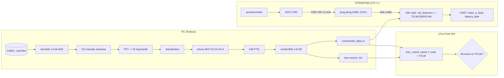
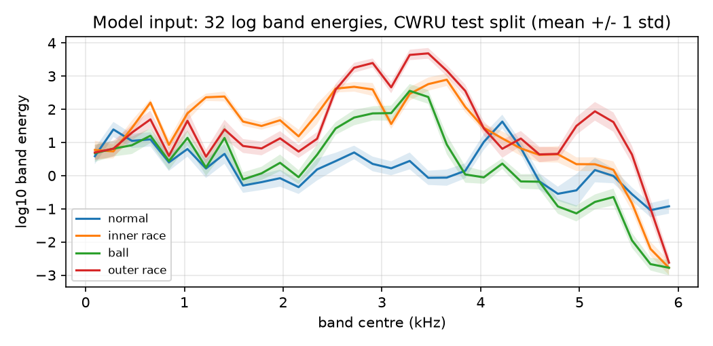

# stm32-tinyml-anomaly

Bearing fault detection on an STM32 with TensorFlow Lite Micro and CMSIS-NN.

A vibration window (512 ADC samples at 12 kHz) goes through an FFT, gets
reduced to 32 log band energies, and a small int8 neural network says
whether the bearing is normal or has an inner race, ball or outer race
fault. Training is in Python/Keras on the public CWRU bearing dataset. The
model is int8 quantized, exported as a C array, and run with TFLM on a
NUCLEO-F446RE. The same C code also builds on Linux, and a host test checks
that the C side gives exactly the same int8 outputs as the TFLite
interpreter in Python.

**Not hardware tested yet.** The firmware builds (numbers below), but I
haven't flashed it to a board or hooked up an accelerometer. Everything
marked "measured" in this README was measured on the host. On-device latency
and sampling jitter are printed by the firmware, but I don't have those
numbers yet.

## Why I built this

I've done a lot of firmware and diagnostics work but never put a neural
network on a microcontroller myself. I wanted to go through the whole chain
once: real sensor data, feature extraction that I can also run in C,
quantization, and the part I care most about as an embedded engineer, which
is proving that what runs on the MCU is the same thing I evaluated in
Python. Vibration on rotating machines is a typical TinyML use case
(predictive maintenance), and the CWRU data is public, so the results can be
reproduced.

## Block diagram



## Data

[CWRU Bearing Data Center](https://engineering.case.edu/bearingdatacenter),
drive-end accelerometer, 0.007 inch faults, motor loads 0 to 3 hp. 16
recordings: 4 classes x 4 loads. `train/cwru.py` downloads them (~70 MB) into
`data/`, which is not committed.

- The fault files are sampled at 12 kHz. The normal baseline files are at
  48 kHz, so I decimate those by 4 (FIR, zero phase).
- To train on what the MCU would actually see, every signal goes through a
  simulated 12 bit ADC first: +/-8 g full scale, 3.9 mg per count, clipped.
- Each recording is split **in time** before windowing: first 70 % train,
  next 15 % validation, last 15 % test. Windows overlap 50 % for training,
  but no window crosses from one split into another.

| split | windows | normal / inner / ball / outer |
|-------|--------:|-------------------------------|
| train | 5138 | 1154 / 1329 / 1326 / 1329 |
| val   | 1084 | 243 / 281 / 280 / 280 |
| test  | 1084 | 243 / 281 / 280 / 280 |

## Features

`train/features.py` (numpy) and `core/vib_features.c` (C, float32) do the
same thing:

1. ADC counts to g, remove the window mean
2. Hann window
3. 512 point FFT, power of bins 1..256 (23.4 Hz per bin, up to 6 kHz)
4. sum into 32 bands of 8 bins (187.5 Hz each)
5. `log10(band + 1e-9)`

Then each band is standardized with the training set mean/std (stored in
`model_data.cc`) and quantized with the model's input scale/zero point.



The classes separate clearly in the 2.5 to 3.7 kHz bands (bearing resonance
excited by the fault impacts) and around 5 kHz for outer race faults. This is
also why the accuracy below is so high, see Limitations.

## Model

Small MLP, chosen because every op has an int8 CMSIS-NN kernel and it fits
in a few KB:

```
bands[32] -> Dense 24 ReLU -> Dense 16 ReLU -> Dense 4 -> Softmax
```

1,260 parameters, 1,216 multiply-accumulates per inference. Dropout 0.1,
Adam, early stopping on validation loss (stopped after 56 epochs). Training
is seeded, and on my machine two runs gave a byte-identical .tflite.

Post-training quantization with a 500 window representative set, full int8
including input and output (`TFLITE_BUILTINS_INT8`). After conversion the
graph is 3x FULLY_CONNECTED + SOFTMAX, so the firmware only registers those
two ops (`MicroMutableOpResolver<2>`).

## Results

All numbers from `make train` and `make robustness` on my machine, stored in
`docs/metrics.json` and `docs/robustness.json`.

| | float32 | int8 |
|---|---:|---:|
| test accuracy (1084 windows) | 100.0 % | 100.0 % |
| int8 vs float prediction agreement | | 100.0 % |
| false alarms (normal called fault) | | 0 / 243 |
| missed faults (fault called normal) | | 0 / 841 |
| .tflite size | 7,100 B | 4,808 B |
| leave-one-load-out (train 3 loads, test the 4th) | | 100 % for each of 0/1/2/3 hp |

Harder checks on the same int8 model, no retraining:

| test | result |
|---|---|
| unseen fault size (0.021", 5702 windows) | 99.6 % still flagged as a fault, but fault **type** only 65.8 % right. Most 0.021" outer race windows are called inner race (1647 of 1903) |
| white noise added, SNR 30 dB | 100 % accuracy |
| SNR 20 dB | 91.8 %, miss rate 10.6 %, false alarms 0 % |
| SNR 10 dB | 74.2 %, miss rate 33.3 %, false alarms 0 % |
| SNR 0 dB | 63.7 %, miss rate 26.2 %, false alarms 0 % |

(Noise is scaled to each window's own RMS, so 20 dB on a quiet normal window
is much less absolute noise than on an outer race window.)

So the honest summary: on the standard CWRU split this problem is easy, and
the model holds up across load changes. It does not generalize to a fault
size it never saw, and it starts missing faults once the noise gets within
about 20 dB of the signal. Interestingly the errors under noise are all
misses, never false alarms, because noise flattens the spectrum and makes a
fault window look more like a normal one.

## C side: does the MCU compute the same thing?

`build/tvec_check` links `core/` (features + TFLM wrapper + model array) with
the TFLM tree built for x86, and runs the test vectors Python exported. It
compares every stage. Output on the full test split (`out/test_all.bin`):

```
vectors            : 1084
arena used         : 1904 of 3072 bytes
feature max |err|  : 6.01e-05 (log10 units)
int8 input off by 1: 0 of 34688 values, worse: 0
tflm vs tflite out : 0 mismatching vectors
class vs python    : 0 differ
accuracy (C path)  : 1.0000 (1084/1084)
host time / window : features 4.7 us, model 0.8 us
confusion (rows=true):
  normal        243     0     0     0
  inner_race      0   281     0     0
  ball            0     0   280     0
  outer_race      0     0     0   280
PASS
```

- TFLM with the CMSIS-NN kernels (their plain C path on x86) is **bit exact**
  against the TFLite interpreter with reference kernels, for all 1084 windows.
- My float32 FFT differs from numpy's float64 FFT by at most 6e-5 in log10
  units, which never changed a single quantized input value.
- The arena number is from a 64 bit build. On the Cortex-M4 it should be a bit
  smaller (4 byte pointers). The firmware prints the real value at boot.
- The host timings are an x86 laptop, they say nothing about the MCU.

The committed `host/vectors/test_vectors.bin` (64 windows, 16 per class) is
what CI runs, so the test doesn't need the dataset.

## Firmware

NUCLEO-F446RE (Cortex-M4F, 180 MHz, 512 KB flash, 128 KB RAM), PlatformIO,
Arduino core for STM32 (PlatformIO package framework-arduinoststm32 4.30000) + STM32duino FreeRTOS.

- **Sampling:** TIM2 interrupt at 12 kHz. The ISR reads ADC1 (PA0 / A0)
  from the conversion it started on the previous tick, starts the next one,
  and stores the sample in a ping-pong buffer. I set up ADC1 at register
  level because `analogRead()` reconfigures the ADC on every call. The ISR
  priority is 6 so it may call FreeRTOS `FromISR` functions.
- **Jitter:** the ISR timestamps itself with the DWT cycle counter. The stats
  task prints min / max / std of the sample period every 5 s, plus overruns
  (a buffer filled before inference finished with the previous one).
- **Inference task:** woken by `vTaskNotifyGiveFromISR` when 512 samples are
  ready, runs features + TFLM, times both with DWT, prints class and
  `p_fault = 1 - p_normal`.
- **Boot self-test:** 8 of the test windows are compiled into flash
  (`selftest_vectors.h`). At boot the board runs them and prints whether the
  int8 scores match what the TFLite interpreter gave in Python. This is the
  first thing I'll look at when I flash it.
- Accelerometer: any analog one with output centred on mid-supply works with
  this code, e.g. an ADXL1002 breakout (+/-50 g, so `FEAT_ADC_LSB_G` would
  need to change, and the model retrained for that scale).

### Memory (from the linker, `pio run`)

| | flash | RAM (static) |
|---|---:|---:|
| whole firmware | 94,800 B (18.1 %) | 16,608 B (12.7 %) |
| self-test only build (no FreeRTOS, no sampling) | 80,024 B | 13,948 B |

Biggest items I added, from `arm-none-eabi-nm`:

| symbol | where | size |
|---|---|---:|
| `g_model_tflite` | flash | 4,808 B |
| `selftest_win` (8 windows) | flash | 8,192 B |
| `g_arena` (TFLM tensor arena) | RAM | 3,072 B |
| FFT work buffers + Hann/twiddle/bit-reverse tables | RAM | 9,216 B |
| ADC ping-pong buffer | RAM | 2,048 B |

FreeRTOS task stacks (4 KB + 2 KB) come from the heap at runtime and are not
in the static RAM number.

### Latency (estimate, not measured)

My back-of-the-envelope for the M4F at 180 MHz: the 512 point radix-2 FFT
is 2,304 butterflies, at roughly 20-25 cycles each that's about 50-60k
cycles, plus windowing and 32 `log10f` calls, so roughly 0.3-0.4 ms for
features. The model is 1,216 MACs, probably well under 0.1 ms with CMSIS-NN.
So well under 1 ms per 42.7 ms window. The firmware prints the real numbers;
until I run it these are guesses.

## Build and run

Needs Python 3.10+, gcc/g++, make, and PlatformIO for the firmware.

```sh
pip install -r requirements.txt
./tools/fetch_tflm.sh          # pinned tflite-micro commit -> third_party/tflm (not committed)

make test                      # C unit tests + test vectors through TFLM
make pytest                    # python tests (also runs the C programs)
make asan                      # C tests again with ASan/UBSan

make train                     # download CWRU, train, quantize, export, leave-one-load-out
make robustness                # 0.021" faults + noise
python tools/plot_features.py  # docs/band_energies.png

make firmware                  # = cd firmware && pio run
cd firmware && pio run -t upload && pio device monitor
```

`make train` overwrites `core/model_data.cc`, `host/vectors/test_vectors.bin`
and `docs/metrics.json`. After that, run
`python tools/vectors_to_header.py` to refresh the firmware self-test vectors.

```
.
├── train/        cwru.py, features.py, model.py, quantize.py, train.py, robustness.py, export_c.py
├── core/         vib_features.c/h, anomaly_model.cc/h, model_data.cc/h (generated)
├── host/         tvec_check.cc, test_features.c, tflm_host_port.cc, vectors/
├── firmware/     platformio.ini, src/main.cpp, src/tflm_port.cpp, src/selftest_vectors.h
├── tests/        pytest
├── tools/        fetch_tflm.sh, tflm_library.json, vectors_to_header.py, plot_features.py
├── docs/         metrics.json, robustness.json, band_energies.png
└── .github/workflows/ci.yml
```

## Tests

- `host/test_features.c`: a tone lands in the right band, DC is removed,
  doubling amplitude adds log10(4), quantize clamps.
- `host/tvec_check.cc`: the stage-by-stage comparison above.
- `tests/` (pytest, 15 tests): numpy features, time split has no overlap,
  `train/config.py` and `core/vib_features.h` agree on every constant, the
  exported C array is a valid int8 model with only FULLY_CONNECTED and
  SOFTMAX, the interpreter reproduces the stored outputs, and the C programs
  pass.
- CI: host build + tests + ASan, firmware build, and a manual retrain job.

## Things I hit along the way

- **`core/features.h` broke `<stdint.h>`.** With `-Icore`, glibc's
  `#include <features.h>` picked up my header instead of its own. The errors
  were nonsense (`missing binary operator before token "("` inside
  libc-header-start.h). Renamed it to `vib_features.h`.
- **The normal data is 48 kHz.** All CWRU fault files I used are 12 kHz, the
  normal baseline is 48 kHz. Without decimating, "normal" windows covered 4x
  less time and a 4x wider band, and the model would learn the sample rate
  instead of the bearing.
- **99.mat also contains the arrays from 98.mat.** Picking "the first key
  that ends in `_DE_time`" silently loads the wrong recording. I pick the key
  by file number.
- **Rounding.** `np.round` rounds halves to even, `roundf` in C rounds away
  from zero. It never actually made a difference on this data, but I switched
  the Python side to the C rule so the comparison is apples to apples.
- **`dwt_init` already exists** in the STM32 Arduino core, so my function of
  the same name didn't compile. Renamed it.
- **`micro_time.cc` from TFLM's cortex_m_generic** expects a CMSIS device
  header macro I don't have in the Arduino build. I excluded it and wrote my
  own `tflm_port.cpp` using `DWT->CYCCNT`.
- My dev container has no g++ (and apt was broken), so I built the host side
  with `zig c++` (clang). CI uses the normal Ubuntu gcc/g++. ASan for the C++
  part only runs in CI because zig doesn't ship the ASan runtime.

## Limitations

- **Not tested on hardware.** No flashed board, no real accelerometer, no
  measured latency, jitter or ARM arena size yet.
- **CWRU is an easy, lab dataset.** One test rig, seeded faults, clean
  signals. 100 % here doesn't mean 100 % on a real motor. The 0.021" result
  (65.8 % fault type) shows how quickly it drops outside the training
  conditions.
- **Possible recording artifact.** The normal files come from a different
  sample rate and anti-alias chain than the fault files. In the plot the top
  bands (5.5-6 kHz) of normal look different from all faults, which might be
  partly the decimation filter and not the bearing. I haven't done the
  ablation (retrain without the top bands) yet.
- **Supervised, closed set.** It can only say one of the 4 classes. A fault
  type it never saw, or a totally different machine, will still be forced
  into one of them. That's not real anomaly detection in the "unknown
  unknowns" sense.
- The time split keeps windows apart, but train and test still come from the
  same recording, so the same bearing and sensor mounting.
- Float FFT on the MCU (portable radix-2, not CMSIS-DSP). The tables are
  built in RAM at boot (about 5 KB that could live in flash).
- ADC scale and accelerometer sensitivity are assumed (+/-8 g over 12 bits).

## Next steps

- Flash it, get the real latency, jitter and arena numbers, fill the tables.
- Ablation without the top bands to rule out the recording artifact.
- Autoencoder (or one-class) model trained on normal only, using
  reconstruction error as the anomaly score. That handles fault types I
  don't have labels for.
- Train with noise augmentation and the 0.014" faults, test on 0.021".
- CMSIS-DSP `arm_rfft_fast_f32` instead of my FFT, const tables in flash.
- Collect my own data with a real accelerometer on a small motor/fan with an
  added imbalance, and see how far the CWRU model transfers (I expect: not
  far, without retraining).

## License

MIT, see [LICENSE](LICENSE). TFLite Micro, CMSIS and CMSIS-NN are Apache 2.0
and are fetched at build time, not included here. The CWRU data belongs to
Case Western Reserve University and is downloaded from their site.
